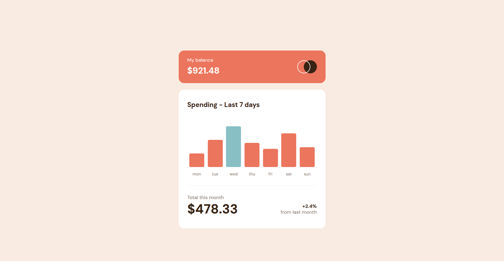
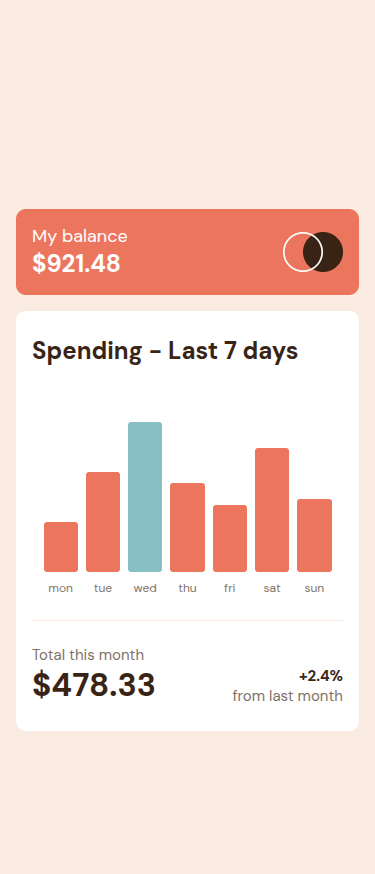

# Frontend Mentor - Expenses chart component solution

This is a solution to
the [Expenses chart component challenge on Frontend Mentor](https://www.frontendmentor.io/challenges/expenses-chart-component-e7yJBUdjwt).
Frontend Mentor challenges help you improve your coding skills by building realistic projects.

## Table of contents

- [Overview](#overview)
  - [The challenge](#the-challenge)
  - [Screenshot](#screenshot)
  - [Links](#links)
- [My process](#my-process)
  - [Built with](#built-with)
  - [What I learned](#what-i-learned)
  - [Continued development](#continued-development)
  - [Useful resources](#useful-resources)
  - [AI Collaboration](#ai-collaboration)
- [Getting started](#getting-started)
- [Author](#author)

## Overview

### The challenge

Users should be able to:

- View the bar chart and hover over the individual bars to see the correct amounts for each day
- See the current day’s bar highlighted in a different colour to the other bars
- View the optimal layout for the content depending on their device’s screen size
- See hover states for all interactive elements on the page
- **Bonus**: Use the JSON data file provided to dynamically size the bars on the chart

On top of that, the component is usable without a mouse: every bar can be reached with the keyboard (or tapped on a
touch screen) to reveal its amount, and screen readers announce each bar as “Wednesday: $52.36 (today)”.

### Screenshot

| Desktop                                     | Mobile                                    |
| ------------------------------------------- | ----------------------------------------- |
|  |  |

### Links

- Solution URL: [github.com/runny-life/expenses-caart-component](https://github.com/runny-life/expenses-caart-component)
- Live Site URL: _add after deploying_

## My process

### Built with

- Semantic HTML5 markup (`main`, labelled `section`s, a real `ul` for the chart)
- SCSS with CSS Modules, shared variables, mixins and functions
- Flexbox and CSS Grid
- Mobile-first workflow with a single `tablet` breakpoint (768px)
- Fluid spacing via a custom SCSS `fluid()` function that outputs `clamp()`
- [React 19](https://react.dev/) - UI library
- [Vite](https://vite.dev/) - build tool and dev server
- ESLint, Prettier, Husky and lint-staged - code quality on every commit

### What I learned

**An accessible chart does not need a charting library.** Each bar is a list item. The visual parts (the coloured bar,
the abbreviated day label and the tooltip) are `aria-hidden`, and a visually hidden span carries the full sentence for
screen readers. The item is focusable, so the tooltip opens on keyboard focus and on tap, and `Escape` dismisses it.

```jsx
<li className={styles.chartBar} tabIndex={0} onKeyDown={handleKeyDown}>
  <div className={styles.bar} style={{ height: `${heightPercent}%` }} aria-hidden="true">
    <span className={styles.tooltip}>{formattedAmount}</span>
  </div>
  <span className={styles.day} aria-hidden="true">
    {day}
  </span>
  <span className={styles.srOnly}>
    {dayName}: {formattedAmount}
    {isToday ? ' (today)' : ''}
  </span>
</li>
```

**Percentage heights need a definite parent.** My first version applied the percentage height to a wrapper that also
contained the day label, so the bars were not proportional to the data (the smallest bar was drawn at about half of its
real size). Giving the bar a fixed-height grid row fixes it, and the tallest bar now measures exactly 150px.

```scss
.chartBar {
  display: grid;
  grid-template-rows: rem(150px) auto;
}

.bar {
  align-self: end; // height: N% now resolves against the 150px row
}
```

**Smaller things worth remembering**

- `Intl.NumberFormat` formats every amount in one place, so `$921.48`, `$478.33` and the tooltips can never drift apart.
- The “today” bar is found by day key (`mon`, `tue`, …) instead of array position, so it keeps working if the JSON order
  changes.
- Vite’s `additionalData` plus a `@` alias keeps SCSS imports short without repeating `@use` in every module.
- Text colours were checked against WCAG AA; the original muted brown (`#92857a`, 3.6:1 on white) was darkened to
  `#7d7065` (4.8:1).

### Continued development

- Add tests (React Testing Library plus an `axe` check) so the accessibility work does not regress.
- Compute the monthly total and the percentage change from real data instead of constants; the 7-day JSON file cannot
  provide them.
- Support `prefers-contrast` and `forced-colors`, and add a non-colour cue for the current day's bar.
- Try the chart with VoiceOver on iOS and TalkBack on Android; so far it has only been checked in desktop Chromium.

### Useful resources

- [WCAG 2.2: Content on Hover or Focus](https://www.w3.org/WAI/WCAG22/Understanding/content-on-hover-or-focus.html) -
  the rules behind the dismissible, focus-reachable tooltip.
- [WCAG 2.2: Use of Color](https://www.w3.org/WAI/WCAG22/Understanding/use-of-color.html) - why “today” should not rely
  on colour alone.
- [WebAIM Contrast Checker](https://webaim.org/resources/contrastchecker/) - used to check text and graphic contrast.
- [MDN: Intl.NumberFormat](https://developer.mozilla.org/en-US/docs/Web/JavaScript/Reference/Global_Objects/Intl/NumberFormat) -
  currency formatting.

### AI Collaboration

I used Claude to audit the finished project for accessibility and to draft this README. It found, among other things,
that the bars were not proportional to the data, that the chart was invisible to screen readers and keyboard users, and
that the monthly total was calculated from the 7-day data instead of matching the design. I reviewed the changes and
checked them in a headless browser (bar heights against the JSON values, keyboard focus, touch tap and the accessibility
tree). It worked well for finding issues quickly; the colour-contrast fixes still needed a design decision from me.

## Getting started

```bash
npm install
npm run dev     # start the dev server
npm run build   # production build
npm run lint    # run ESLint
```

## Author

- GitHub - [@runny-life](https://github.com/runny-life)
